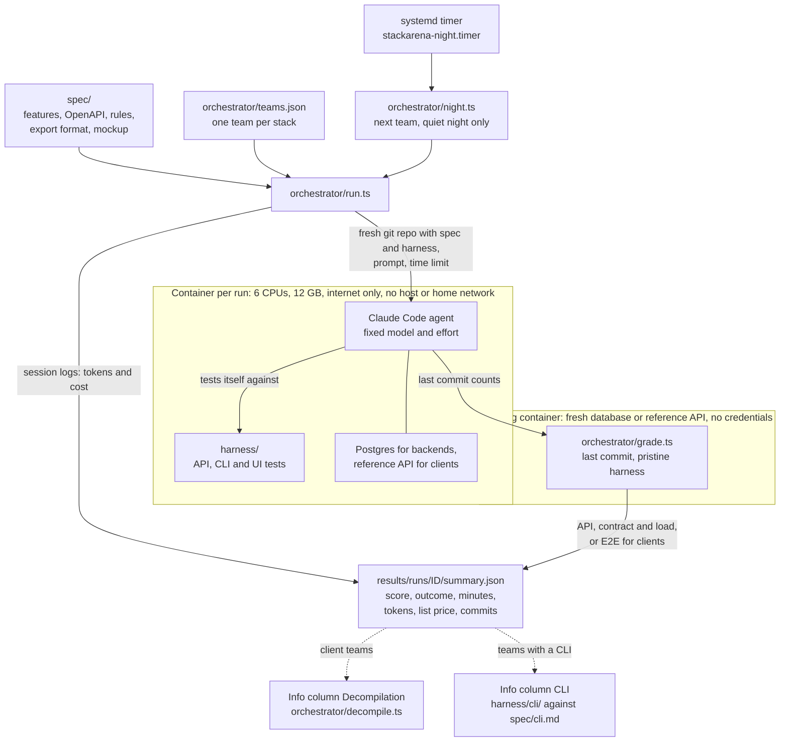

# Stackarena

Stackarena makes agent work measurable. Coding agents build the same habit tracker, specified once in
[`spec/`](spec/), autonomously and on many different stacks. Every run happens in its own
locked-down container with the same model and toolchain under a hard time limit. Afterwards a
separate grading step tests the team's last commit with the same harness, and every run is recorded
the same way: score, outcome, time, tokens and cost.

## How a run works



- **Spec.** [`spec/features.md`](spec/features.md) lists features and deliverables;
  [`openapi.yaml`](spec/openapi.yaml), [`rules.md`](spec/rules.md) (due days, streaks, rates),
  [`export.md`](spec/export.md), [`test-ids.json`](spec/test-ids.json) and an approved
  [mockup](spec/mockup/index.html) are binding. Clients and backends are separate teams and meet
  only at the OpenAPI contract, so every client must work with every backend.
- **Orchestrator.** [`orchestrator/run.ts`](orchestrator/run.ts) takes a team from
  [`teams.json`](orchestrator/teams.json), builds a fresh repository from `spec/` and `harness/` at
  a pinned revision (the reference implementation stays out), fills in the
  [prompt](orchestrator/prompt.md) and starts the agent with a hard time limit. Afterwards it reads
  token usage from the session logs, prices it, writes `summary.json` and has the run graded.
- **Container.** One Docker Compose project per run, with its own network.
  [`init.sh`](orchestrator/init.sh) blocks the host, private ranges and other containers, then drops
  all capabilities before the agent starts. Backend teams get Postgres, client teams a reference
  backend whose port they see but whose source they don't.
- **Harness.** [`harness/`](harness/) holds seed data, API and sync tests (`bun test`), an
  OpenAPI contract run (Schemathesis), a load test, Playwright UI scenarios and the CLI tests.
  `bun run verify` checks the harness itself against the reference backend and the mockup.
- **Grading.** [`grade.ts`](orchestrator/grade.ts) grades every run independently of the agent. It
  takes only what the team committed, next to `spec/` and `harness/` from the run's source revision
  (so changes the agent made there don't count), and starts it in a new container with a fresh
  database or reference API and no model credentials. Each part scores passed / (passed + failed),
  and the run's score is the unweighted mean of its parts:
  - Backends, started with their `start.sh`: the **API** suite (`bun test api/`), a **contract**
    run with Schemathesis against `openapi.yaml` (100 examples per operation, fixed seed, so every
    backend gets the same requests; a test case passes if it passes all checks) and a **load** test
    with k6 (`harness/load/sync.js`: sync, login and health at up to 50 virtual users; a request
    passes with status 200). p95 latency per request and throughput are recorded as info.
  - Clients, served with `serve-web.sh`: the web **E2E** suite on desktop and phone viewports.
    Tests the harness skips for a target don't count. A `cli.sh` is tested as well, as info only.

  Logs and reports land in `results/runs/<id>/grade/`.
- **Night runs.** A systemd user timer calls [`night.ts`](orchestrator/night.ts) every 15 minutes
  between 01:30 and 02:15. It starts the next team only if no run is going and nobody has been
  working in an interactive agent session for 20 minutes, sizes the time limit so the run ends by
  about 04:45, and checks after one minute that the run really started.
- **Live view.** `bun orchestrator/live/server.ts` serves a read-only view of all runs on
  `http://127.0.0.1:4520`: transcripts, commits, the agents' own test runs, cost over time and,
  once graded, each run's score with its parts.

### Info columns

These are shown next to the contest and do not count towards it.

- **Decompilation** ([`decompile.ts`](orchestrator/decompile.ts)). An agent with the source packs
  a client's web and Linux builds as users get them. Then one agent per target, without the source,
  analyses the shipped build and answers six fixed questions from
  [`questions.ts`](orchestrator/questions.ts): backend URL, endpoints, streak rule, rate rounding,
  heatmap, German strings. Answers are scored mechanically against `spec/`; no agent grades another.
  Each agent has a fixed time and dollar budget, enforced from the session logs.
- **CLI.** Teams with a shared core (so far `client/rust-core`) also ship a CLI on that core,
  following [`spec/cli.md`](spec/cli.md). [`harness/cli/`](harness/cli/) checks it against the rule
  reference, including sync and export.

## Results

Completed contest runs so far, taken from `results/runs/*/summary.json` (the directory itself is
not checked in). Model `claude-opus-5-5` with effort `xhigh` in every run.

| Run | Stack | Started (UTC) | Minutes / limit | Outcome | List price | Billing | Commits | Spec |
|---|---|---|---|---|---|---|---|---|
| `backend-bun-1` | Bun, Hono, Drizzle ORM | 2026-10-07 09:41 | 88.8 / 240 | success | $25.57 | not recorded | 28 | [`2686316`](https://github.com/robinchoice/stackarena/commit/2686316dd7c76251fcd02446c4e1020dcfa56b62) |
| `backend-deno-1` | Deno, Hono, Drizzle ORM | 2026-10-17 22:45 | 98.0 / 240 | success | $19.50 | api | 22 | [`382fa60`](https://github.com/robinchoice/stackarena/commit/382fa60a1e649fc64223e51d74ffd8388e61a9aa) |
| `backend-go-1` | Go net/http, sqlc | 2026-10-21 23:45 | 61.0 / 180 | success | $13.60 | api+subscription | 18 | [`0012200`](https://github.com/robinchoice/stackarena/commit/0012200ac7c51823da4b13385d48eb8dd5a40106) |
| `backend-rust-1` | Axum, sqlx | 2026-10-22 23:30 | 84.9 / 195 | success | $18.23 | api+subscription | 17 | [`0012200`](https://github.com/robinchoice/stackarena/commit/0012200ac7c51823da4b13385d48eb8dd5a40106) |
| `backend-dart-1` | Dart Frog | 2026-10-23 23:30 | 88.7 / 195 | success | $19.55 | api+subscription | 18 | [`0012200`](https://github.com/robinchoice/stackarena/commit/0012200ac7c51823da4b13385d48eb8dd5a40106) |
| `backend-python-1` | FastAPI, async SQLAlchemy | 2026-10-24 23:30 | 85.8 / 195 | success | $19.15 | api+subscription | 19 | [`0012200`](https://github.com/robinchoice/stackarena/commit/0012200ac7c51823da4b13385d48eb8dd5a40106) |

### Grades

| Run | Score | API | Contract | Load | p95 ms: sync-delta / sync-full / login / health | Requests/s |
|---|---|---|---|---|---|---|
| `backend-bun-1` | **1.000** | 1.000 (37/37) | 1.000 (805/805) | 1.000 (10717/10717) | 457.1 / 626.9 / 1904.0 / 186.7 | 158.4 |
| `backend-deno-1` | **1.000** | 1.000 (37/37) | 1.000 (805/805) | 1.000 (7943/7943) | 661.1 / 1127.4 / 7324.1 / 421.6 | 114.6 |
| `backend-go-1` | **1.000** | 1.000 (37/37) | 1.000 (805/805) | 1.000 (22782/22782) | 194.1 / 349.7 / 1596.9 / 111.6 | 413.8 |
| `backend-rust-1` | **1.000** | 1.000 (37/37) | 1.000 (805/805) | 1.000 (8587/8587) | 547.0 / 930.9 / 2899.7 / 498.6 | 142.0 |
| `backend-dart-1` | **1.000** | 1.000 (37/37) | 1.000 (805/805) | 1.000 (8856/8856) | 470.2 / 722.8 / 9866.8 / 267.4 | 118.8 |
| `backend-python-1` | **1.000** | 1.000 (37/37) | 1.000 (805/805) | 1.000 (6603/6603) | 1146.4 / 1173.7 / 3502.8 / 1055.2 | 103.1 |

- **Score** is the mean of the API, contract and load parts from `grade.ts`, each given as score
  (passed/total): API tests, Schemathesis test cases and k6 checks. These six runs predate
  `grade.ts` and were graded afterwards from their final commits, each with the harness of its own
  source revision; the contract and load tests are the same in all of them. All six pass every
  part, so the score does not separate them yet.
- **p95 latency and requests/s** are info only. They were measured one run after another on the
  same shared laptop, so other work on it affects them: grading `backend-go-1` again an hour later
  changed them by up to a factor of 2.7. The table shows the latest grading.
- **Outcome** is how the agent's session ended: `success` means the agent finished on its own
  within the limit.
- **List price** is the cumulative list price of all requests, priced from the session logs.
  `api` runs drew on prepaid API credits; `api+subscription` runs used up the credits and continued
  in the same session on a subscription, so the list price covers both parts.
- **Spec** is the revision of this repository whose `spec/` and `harness/` the run started from.
- No client team has run yet. The eight smoke runs of the setup (under 2 minutes and $0.20 each)
  and three decompilation smoke runs on the mockup build (6 of 6 answers, $0.33–0.35 each) are left
  out.

## Running it

Requirements: Linux with Docker, [Bun](https://bun.sh), systemd user units for runs that should
outlive the shell, and a Claude Code token (`claude setup-token`) as `CLAUDE_STACKARENA_TOKEN` in
`~/.secrets`. An optional `ANTHROPIC_STACKARENA_API_KEY` there makes runs bill API credits first.

```sh
# Contest image, tag as in orchestrator/compose.yaml
docker build -t stackarena-run:2 orchestrator

# Orchestrator tests: error paths, source revision and budgets, no Docker or model calls
bun test orchestrator/

# Harness against the reference backend and the mockup
cd harness && bun install && bunx playwright install chromium && bun run verify && cd ..

# Smoke run: real container and agent, 6-minute limit, a few cents. Its grade is 0
# with "no start.sh", because the smoke agent only writes a STATUS.md
bun orchestrator/run.ts --team backend/bun --run 1 --smoke
cat results/runs/smoke-backend-bun-1/summary.json

# Grade a finished run again; updates score and grade in its summary.json
bun orchestrator/grade.ts --run backend-go-1
```

A full run, as its own user unit:

```sh
systemd-run --user --unit stackarena-backend-go-2 --same-dir --collect \
  bun orchestrator/run.ts --team backend/go --run 2 --hours 4
journalctl --user -fu stackarena-backend-go-2
```

A run ID can be used only once; move `runs/<id>` and `results/runs/<id>` aside before you repeat it.

## License

[MIT](LICENSE)
