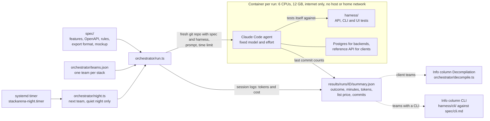

# Stackarena

Stackarena makes agent work measurable. Coding agents build the same habit tracker, specified once in
[`spec/`](spec/), autonomously and on many different stacks. Every run happens in its own
locked-down container with the same model and toolchain under a hard time limit. Every agent tests
against the same harness, and every run is recorded the same way: outcome, time, tokens and cost.

## How a run works



- **Spec.** [`spec/features.md`](spec/features.md) lists features and deliverables;
  [`openapi.yaml`](spec/openapi.yaml), [`rules.md`](spec/rules.md) (due days, streaks, rates),
  [`export.md`](spec/export.md), [`test-ids.json`](spec/test-ids.json) and an approved
  [mockup](spec/mockup/index.html) are binding. Clients and backends are separate teams and meet
  only at the OpenAPI contract, so every client must work with every backend.
- **Orchestrator.** [`orchestrator/run.ts`](orchestrator/run.ts) takes a team from
  [`teams.json`](orchestrator/teams.json), builds a fresh repository from `spec/` and `harness/` at
  a pinned revision (the reference implementation stays out), fills in the
  [prompt](orchestrator/prompt.md) and starts the agent with a hard time limit. Afterwards it reads
  token usage from the session logs, prices it and writes `summary.json`.
- **Container.** One Docker Compose project per run, with its own network.
  [`init.sh`](orchestrator/init.sh) blocks the host, private ranges and other containers, then drops
  all capabilities before the agent starts. Backend teams get Postgres, client teams a reference
  backend whose port they see but whose source they don't.
- **Harness.** [`harness/`](harness/) holds seed data, API and sync tests (`bun test`), an
  OpenAPI contract run (Schemathesis), a load test, Playwright UI scenarios and the CLI tests.
  `bun run verify` checks the harness itself against the reference backend and the mockup.
- **Night runs.** A systemd user timer calls [`night.ts`](orchestrator/night.ts) every 15 minutes
  between 01:30 and 02:15. It starts the next team only if no run is going and nobody has been
  working in an interactive agent session for 20 minutes, sizes the time limit so the run ends by
  about 04:45, and checks after one minute that the run really started.
- **Live view.** `bun orchestrator/live/server.ts` serves a read-only view of all runs on
  `http://127.0.0.1:4520`: transcripts, commits, the agents' own test runs and cost over time.

### Info columns

These are shown next to the contest and do not count towards it.

- **Decompilation** ([`decompile.ts`](orchestrator/decompile.ts)). An agent with the source packs
  a client's web and Linux builds as users get them. Then one agent per target, without the source,
  analyses the shipped build and answers six fixed questions from
  [`questions.ts`](orchestrator/questions.ts): backend URL, endpoints, streak rule, rate rounding,
  heatmap, German strings. Answers are scored mechanically against `spec/`; no agent grades another.
  Each agent has a fixed time and dollar budget, enforced from the session logs.
- **CLI.** Teams with a shared core (so far `client/rust-core`) also ship a CLI on that core,
  following [`spec/cli.md`](spec/cli.md). [`harness/cli/`](harness/cli/) checks it against the rule
  reference, including sync and export.

## Results

Completed contest runs so far, taken from `results/runs/*/summary.json` (the directory itself is
not checked in). Model `claude-opus-5-5` with effort `xhigh` in every run.

| Team | Stack | Run | Started (UTC) | Minutes / limit | Outcome | List price | Billing | Requests | Commits | Spec revision |
|---|---|---|---|---|---|---|---|---|---|---|
| backend/bun | Bun, Hono, Drizzle ORM | `backend-bun-1` | 2026-10-07 09:41 | 88.8 / 240 | success | $25.57 | not recorded | 323 | 28 | [`2686316`](https://github.com/robinchoice/stackarena/commit/2686316dd7c76251fcd02446c4e1020dcfa56b62) |
| backend/deno | Deno, Hono, Drizzle ORM | `backend-deno-1` | 2026-10-17 22:45 | 98.0 / 240 | success | $19.50 | api | 251 | 22 | [`382fa60`](https://github.com/robinchoice/stackarena/commit/382fa60a1e649fc64223e51d74ffd8388e61a9aa) |
| backend/go | Go net/http, sqlc | `backend-go-1` | 2026-10-21 23:45 | 61.0 / 180 | success | $13.60 | api+subscription | 172 | 18 | [`0012200`](https://github.com/robinchoice/stackarena/commit/0012200ac7c51823da4b13385d48eb8dd5a40106) |
| backend/rust | Axum, sqlx | `backend-rust-1` | 2026-10-22 23:30 | 84.9 / 195 | success | $18.23 | api+subscription | 236 | 17 | [`0012200`](https://github.com/robinchoice/stackarena/commit/0012200ac7c51823da4b13385d48eb8dd5a40106) |
| backend/dart | Dart Frog | `backend-dart-1` | 2026-10-23 23:30 | 88.7 / 195 | success | $19.55 | api+subscription | 286 | 18 | [`0012200`](https://github.com/robinchoice/stackarena/commit/0012200ac7c51823da4b13385d48eb8dd5a40106) |
| backend/python | FastAPI, async SQLAlchemy | `backend-python-1` | 2026-10-24 23:30 | 85.8 / 195 | success | $19.15 | api+subscription | 260 | 19 | [`0012200`](https://github.com/robinchoice/stackarena/commit/0012200ac7c51823da4b13385d48eb8dd5a40106) |

- **Outcome** is how the agent's session ended: `success` means the agent finished on its own
  within the limit, not that the result passes the harness. An independent harness score after the
  run is not recorded yet, so the table has no score column.
- **List price** is the cumulative list price of all requests, priced from the session logs.
  `api` runs drew on prepaid API credits; `api+subscription` runs used up the credits and continued
  in the same session on a subscription, so the list price covers both parts.
- No client team has run yet. The eight smoke runs of the setup (under 2 minutes and $0.20 each)
  and three decompilation smoke runs on the mockup build (6 of 6 answers, $0.33–0.35 each) are left
  out.

## Running it

Requirements: Linux with Docker, [Bun](https://bun.sh), systemd user units for runs that should
outlive the shell, and a Claude Code token (`claude setup-token`) as `CLAUDE_STACKARENA_TOKEN` in
`~/.secrets`. An optional `ANTHROPIC_STACKARENA_API_KEY` there makes runs bill API credits first.

```sh
# Contest image, tag as in orchestrator/compose.yaml
docker build -t stackarena-run:2 orchestrator

# Orchestrator tests: error paths, source revision and budgets, no Docker or model calls
bun test orchestrator/

# Harness against the reference backend and the mockup
cd harness && bun install && bunx playwright install chromium && bun run verify && cd ..

# Smoke run: real container and agent, 6-minute limit, a few cents
bun orchestrator/run.ts --team backend/bun --run 1 --smoke
cat results/runs/smoke-backend-bun-1/summary.json
```

A full run, as its own user unit:

```sh
systemd-run --user --unit stackarena-backend-go-2 --same-dir --collect \
  bun orchestrator/run.ts --team backend/go --run 2 --hours 4
journalctl --user -fu stackarena-backend-go-2
```

A run ID can be used only once; move `runs/<id>` and `results/runs/<id>` aside before you repeat it.
